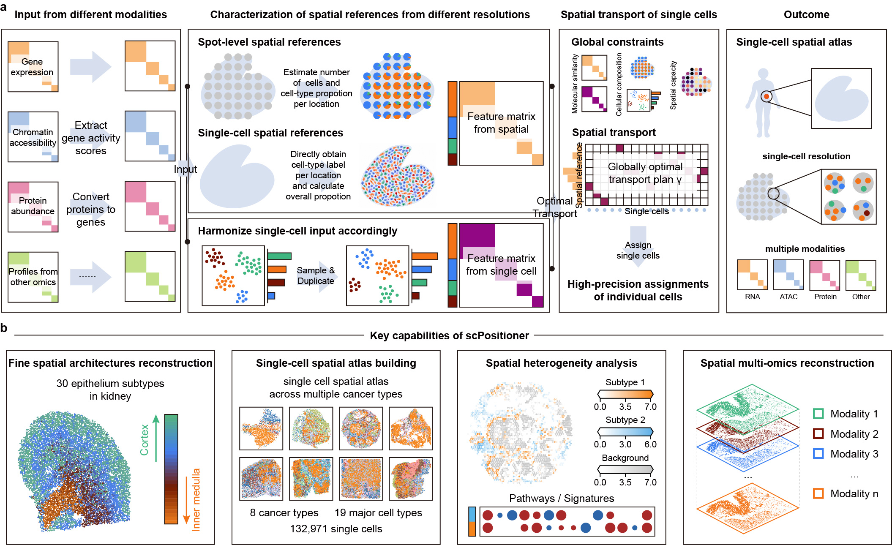

# scPositioner

## A unified framework for fine-grained spatial reconstruction of single-cell multi-omics data

[](https://www.python.org/)

scPositioner is a unified and scalable computational framework for reconstructing single-cell molecular profiles in tissue space across different molecular modalities and spatial resolutions.

Rather than treating different data modalities and spatial technologies as separate mapping problems, scPositioner organizes spatial reconstruction into a shared computational framework with three core components:

1. **Unified representation of molecular modalities**
2. **Spatial reference characterization and cellular composition harmonization**
3. **EMD-based globally constrained spatial assignment**

This modular design allows modality-specific preprocessing and resolution-specific spatial constraints to be handled separately while preserving a common reconstruction principle. As a result, scPositioner can be extended to additional molecular modalities, spatial platforms, and large-scale datasets without redesigning the entire reconstruction workflow.

Different molecular modalities reconstructed within the same spatial context can also be interpreted and compared under a consistent analytical framework. In addition, scPositioner is designed to interface with upstream methods such as spatial deconvolution tools and to preserve the original molecular profiles of mapped cells for downstream spatial, cellular-state, and regulatory analyses.

---

## Framework overview



The scPositioner workflow can be summarized as:

```text
Molecular profiles from different modalities
        |
        |-- RNA expression
        |-- ATAC gene activity
        |-- Protein-associated features
        |-- etc.
        |
        v
Unified gene-associated feature representation
        |
        v
Spatial reference characterization
        |
        |-- Spot-level reference
        |     - estimate spatial capacity
        |     - estimate cell-type composition
        |
        |-- Single-cell-resolution reference
        |     - use measured cell coordinates
        |     - use observed cell-type annotations
        |
        v
Cellular composition harmonization
        |
        v
EMD-based globally coordinated spatial assignment
        |
        v
Reconstructed single-cell spatial atlas
        |
        |-- tissue architecture
        |-- cellular-state heterogeneity
        |-- spatial multi-omics analysis
        |-- etc.
```

---

## Key features

- **Unified reconstruction framework**  
  A common spatial reconstruction principle is used across different molecular modalities and spatial resolutions.

- **Modular upstream interfaces**  
  Spatial deconvolution results can be provided by cell2location (default) or other deconvolution methods (user-provided).

- **Downstream-ready output**  
  Reconstructed cells retain their original molecular profiles and spatial coordinates, enabling downstream analyses of tissue architecture, cellular states, pathways, and regulatory programs.

- **Scalable implementation**  
  A divide-and-conquer strategy supports large datasets containing hundreds of thousands of cells.

---

## Installation

### 1. Create and activate the environment

scPositioner requires Python >= 3.9.

If you use Conda, we recommend creating a dedicated environment:

```bash
cd scPositioner-main

conda env create -f environment.yml -n scpositioner
conda activate scpositioner
```

### 2. Install scPositioner

```bash
python setup.py build
python setup.py install
```

---

## Input requirements

scPositioner requires:

1. At least a single-cell omics dataset
2. A spatial reference dataset
3. Cell-type annotations for the single-cell input
4. (Optional) Cell-type composition

Both datasets are typically provided in `.h5ad` format.

### Single-cell input

The single-cell input should contain:

- Molecular feature matrix
- Cell-type annotation

For non-transcriptomic modalities, the data should first be converted into gene-associated features used for spatial assignment.

### Spot-level spatial reference

For spot-level spatial transcriptomics data, scPositioner requires:

- Spatial coordinates
- Spot-level molecular profiles
- (Optional) Estimated cell-type composition for each spot

If cell-type composition estimates are not available, scPositioner will automatically run cell2location by default. 
Also, a spatial deconvolution method can be used beforehand by users' own.

For example:

- [cell2location](https://github.com/BayraktarLab/cell2location)
- [Example: running cell2location](tutorial/tutorial_runcell2location.ipynb)

### Single-cell-resolution spatial reference

For single-cell-resolution spatial references, scPositioner requires:

- Spatial coordinates
- Molecular profiles of spatial cells
- Cell-type annotations of spatial cells

---

## Quick start

### Modality-specific preprocessing

scPositioner separates modality-specific feature preparation from the shared spatial reconstruction engine.

#### Transcriptomic data

Gene expression profiles can be used directly after standard preprocessing and normalization.

#### Chromatin accessibility data

scATAC-seq or snATAC-seq data can be converted into gene activity scores before spatial reconstruction.

- [Convert ATAC fragments into a gene activity score matrix](tutorial/tutorial_ATACfragments_to_genes.R)

#### Protein-associated data

Protein identifiers can be mapped to corresponding gene symbols to generate gene-associated protein features.

- [Convert protein names into gene names](tutorial/tutorial_protein2genes.R)

### Spot-level spatial reconstruction

```python
import scanpy as sc
import scpositioner

sc_adata = sc.read_h5ad("single_cell.h5ad")
spatial_adata = sc.read_h5ad("spatial_reference.h5ad")

mapper = scpositioner.LowResMapper(
    single_cell=sc_adata,
    spatial_reference=spatial_adata,
    cell_type_key="cell_type"
)

mapped_adata = mapper.run()
mapped_adata.write_h5ad("scpositioner_mapped.h5ad")
```

Full tutorial:

- [Spot-level spatial reconstruction with 10X Visium](tutorial/tutorial_kidney.ipynb)

### Single-cell-resolution spatial reconstruction

```python
import scanpy as sc
import scpositioner

sc_adata = sc.read_h5ad("single_cell.h5ad")
spatial_adata = sc.read_h5ad("single_cell_spatial_reference.h5ad")

mapper = scpositioner.HighResMapper(
    single_cell=sc_adata,
    spatial_reference=spatial_adata,
    cell_type_key="cell_type"
)

mapped_adata = mapper.run()
mapped_adata.write_h5ad("scpositioner_mapped.h5ad")
```

Full tutorial:

- [Single-cell-resolution reconstruction with 10X Xenium](tutorial/tutorial_XeniumBC.ipynb)

---


## Multi-omics spatial reconstruction

Different single-cell modalities can be independently reconstructed onto the same spatial reference, allowing complementary molecular information to be analyzed within a common spatial context.

### Human intestine tri-modal reconstruction

This example demonstrates spatial reconstruction using:

- CODEX spatial protein measurements
- snRNA-seq
- snATAC-seq

Tutorial:

- [Human intestine multi-omics reconstruction](tutorial/tutorial_intestine.ipynb)


## Large-scale spatial reconstruction

For large single-cell-resolution spatial datasets, constructing a full cell-to-location transport matrix may require substantial memory.

scPositioner therefore provides a divide-and-conquer implementation that partitions large mapping tasks into smaller EMD subproblems while retaining the same spatial assignment formulation within each subproblem.

The maximum number of cells processed in each subset can be controlled using:

```python
MAX_NUMBER = 20000
```

The default value is `20,000` and can be adjusted according to available memory and computational resources.

<!--
Add a dedicated large-scale tutorial here if available.

Tutorial:

- [Large-scale reconstruction tutorial](tutorial/tutorial_large_scale.ipynb)
-->

---

## Output

The primary output of scPositioner is an `AnnData` object containing:

- Original molecular profiles of mapped cells
- Cell-type annotations
- Reconstructed spatial coordinates
- Metadata inherited from the original single-cell input
- Additional mapping-related information generated during reconstruction

---

## Downstream analysis

Because mapped cells retain their original molecular profiles, the reconstructed atlas can be directly used for downstream analyses such as:

- Visualization of fine-scale tissue architecture
- Analysis of spatially organized cellular states
- Distance-based spatial heterogeneity analysis
- Differential expression and pathway enrichment
- Transcription factor and regulatory analysis
- Cross-modal comparison within a common spatial context
- Construction of single-cell spatial multi-modal atlases

scPositioner does not impose a specific downstream analysis workflow and can be used together with commonly used single-cell and spatial analysis tools.

---

## Tutorials

### Spatial reconstruction

- [Spot-level spatial reconstruction: mouse kidney / 10X Visium](tutorial/tutorial_kidney.ipynb)
- [Single-cell-resolution spatial reconstruction: human breast cancer / 10X Xenium](tutorial/tutorial_XeniumBC.ipynb)

### Upstream processing

- [Spatial deconvolution with cell2location](tutorial/tutorial_runcell2location.ipynb)

### Modality preprocessing

- [Protein-to-gene conversion](tutorial/tutorial_protein2genes.R)
- [ATAC fragments to gene activity](tutorial/tutorial_ATACfragments_to_genes.R)

### Multi-omics reconstruction

- [Human intestine multi-omics reconstruction](tutorial/tutorial_intestine.ipynb)

---

## Citation

If you use scPositioner in your work, please cite:

```text
[PLACEHOLDER]

Bao H., et al.
A unified framework for fine-grained spatial reconstruction of single-cell multi-omics data.
[Journal / preprint / year / DOI]
```

Software release:

```text
scPositioner v1.0.0
```

---

## Availability

scPositioner is distributed as an open-source Python package.

---

## Contact

scPositioner is developed by Jingyang Qian and Hudong Bao.

For questions or feedback, please contact:

**Hudong Bao**  
Email: baohd@zju.edu.cn

Issues and feature requests are also welcome through the GitHub issue tracker.
